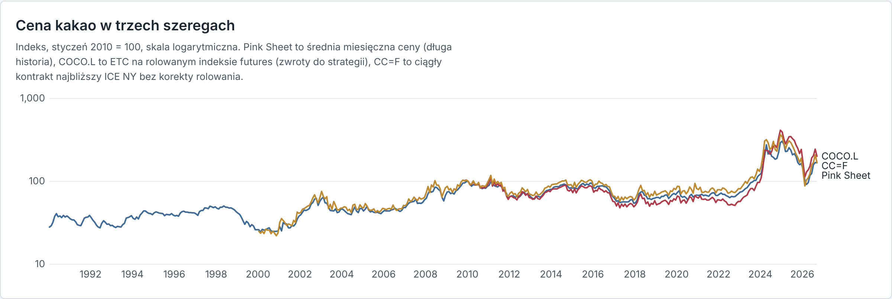
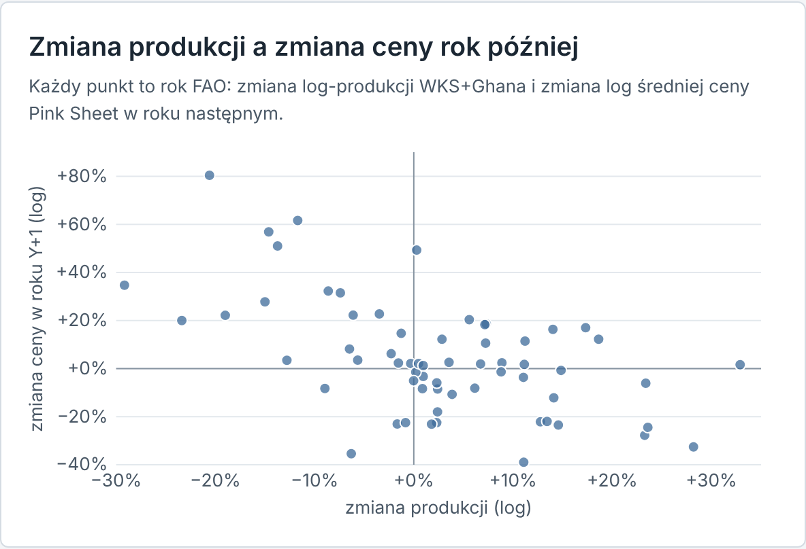

# Cocoa: weather, harvests and price

Does observed weather in the West African cocoa belt give a usable edge on the cocoa price?
This is an exploratory study of the chain **weather → harvest → price → chocolate stocks**
on public data. Each link is tested separately, and the specification was pre-registered
before looking at prices.

**Short answer:** the link from harvests to price is strong. The link from weather to harvests
replicates the published result for Ghana. A tradable weather → price signal did not show up.

[Interactive dashboard (first pass, in Polish)](https://maciejkarawan.github.io/cocoa/)



## Key results

| Link | Result |
|---|---|
| Price seasonality (66 years of monthly data) | Not detected. A calendar strategy loses out of sample. |
| Weather / ENSO → 1–6 month returns | Nothing survives Benjamini–Hochberg correction. |
| Harvest → price | Strong. Spearman −0.35 to −0.44 within the same season, elasticity −0.41 to −0.95. The first pass, using the FAO total against next-year price, gives −0.50 and elasticity −1.07. |
| Weather → harvest, Ghana (positive control) | Replicates Albright et al. (PNAS 2026): R² 0.59 vs 0.68 in the paper. Signs match: heavy rain hurts, dry-season rain helps. |
| Weather → harvest, Côte d'Ivoire | The paper's specification fails (R² 0.14). In first differences the dry season is significant: R² 0.45, out-of-sample 0.38. |
| Dry-season rain → price (pre-registered, n = 42 seasons) | Not detected in either variant: slope +0.050 and −0.001 per sd, against the −0.04 to −0.05 the full chain implies. |
| Cocoa → chocolate makers (HSY, MDLZ, Barry Callebaut) | Same-month beta −0.11 to −0.15. No delayed reaction. |

The contemporaneous price reaction to the dry season (p = 0.045) depends on the 2025/26
season. Without it, the reaction is not significant.



## What was involved

- **Data contract.** All sources, with their licences and known problems, are listed in
  [`data/CATALOG.md`](data/CATALOG.md):
  - prices: Yahoo Finance and the World Bank Pink Sheet;
  - weather: NASA POWER, TAMSAT v3.1 and CHIRPS v2.0;
  - climate indices: NOAA CPC ENSO indices and bulletins;
  - harvests: FAOSTAT, ICCO, COCOBOD and USDA FAS.
- **Data forensics.** FAOSTAT assigns Ghana's crop year to the wrong season before 1996 and
  has wrong levels in 1988, 2005, 2011 and 2014–2016. The Ghana series was rebuilt from the
  COCOBOD purchase records. Without this fix, the pre-2000 relationship
  disappears.
- **Pre-registration.** Every test has a written specification and decision rule set before
  the run. Post-hoc checks are labelled as such.
- **Methods:**
  - OLS with HAC (Newey–West) errors;
  - expanding-window out-of-sample R² with the Clark–West test;
  - minimum detectable effects (MDE) to state what "not detected" can and cannot rule out;
  - Benjamini–Hochberg correction across test families.

## Structure

```
src/
  pobierz.py        download public sources into data/raw (existing files are not overwritten)
  opad.py           cut TAMSAT / CHIRPS NetCDF to the West Africa window (needs h5py)
  dane.py           loaders and cleaning for every source
  analiza.py        first pass: seasonality, weather → price, harvest → price, stocks, ENSO bulletins
  eksport.py        dashboard datasets (JSON)
  zbiory_pogoda.py  weather → harvest, Ghana (positive control + Δlog test)
  zbiory_wks.py     weather → harvest, Côte d'Ivoire
  zbiory_cena.py    harvest → price by season
  pogoda_cena.py    pre-registered dry-season rain → price test
wyniki/             result JSONs
data/CATALOG.md     sources, licences, known data issues
docs/wynik_pl.md    full results log with every specification (Polish)
```

Code comments and variable names are in Polish.

## How to run

```bash
pip install -r requirements.txt
python src/pobierz.py            # Yahoo, NASA POWER, World Bank, FAOSTAT, NOAA CPC
python src/analiza.py
python src/eksport.py
# TAMSAT / CHIRPS NetCDF downloaded separately (see data/CATALOG.md):
python src/opad.py tamsat <path-to-netcdf>
python src/zbiory_pogoda.py
python src/zbiory_wks.py
python src/zbiory_cena.py
python src/pogoda_cena.py
```

Raw data (~200 MB) is not included. COCOBOD tables, ICCO reports and the TAMSAT/CHIRPS
files are listed with their URLs in `data/CATALOG.md`.

## Reference

Albright, Berkoh-Oforiwaa, Huybers (2026), *PNAS*: Ghana, 66 districts, R² 0.68.

## Author

Maciej Karawan
